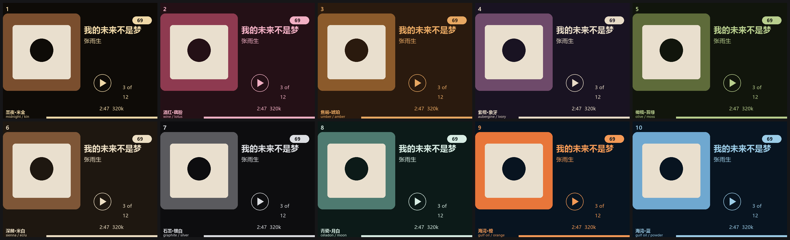

# iPod Classic 一键刷 Rockbox

> ### 第一次刷机？直接看 **[手把手教程](TUTORIAL.md)**
> 零基础版，配图，不用懂任何技术名词。下面这篇是给想了解原理和细节的人看的。

> 把一台原厂 iPod Classic 刷成 Rockbox 开源系统，装上中文主题。
> 手工 51 个动作，压到 **3 个**：双击、按住两个键 12 秒、拔线。



<sub>同一台机器，十种配色，随时切换</sub>

---

## 这是什么

iPod Classic 的原厂系统必须靠 iTunes 同步，格式支持也窄。刷成 Rockbox 之后：

- **拖进去就能播** —— FLAC / APE / WAV / MP3 / M4A / OGG / OPUS 都行，不用 iTunes，不用同步
- **可逆** —— bootloader 是双启动的，开机按住 MENU 随时回原厂系统，也能用 iTunes 恢复
- **界面可换** —— 主题、配色、字体都能自己改

这个仓库把整套流程自动化了，并附带你需要的全部文件。

> ⚠️ **仅适用于 iPod Classic（6 代 / 6.5 代 / 7 代，2007–2009 年，80G / 120G / 160G 厚版和薄版）**
> 其他 iPod 型号看下一节，方法不同。

---

## 三步搞定

### 1. 拿文件

**本仓库只自带 3 个文件**（都是 GPL 开源组件）：

| 文件 | 作用 |
|---|---|
| `rockbox-ipod6g.zip` | Rockbox 系统本体 |
| `bootloader-ipod6g.ipod` | 开机引导程序 |
| `mks5lboot64.exe` | 命令行刷写工具 |

**主题要你自己去作者那儿下**（见下一节，不替作者分发）。

四个文件放同一个目录，脚本自己找，不用改名。

### 1.5 下载主题（强烈建议）

推荐 **Themify 2** —— 它是这套流程里中文化做得最顺的主题，界面元素全部用 Rockbox 的全局前景/背景色渲染，改配色只需两个值。

| 渠道 | 地址 | 说明 |
|---|---|---|
| **主题库（最稳）** | https://themes.rockbox.org/index.php?themeid=4096 | 4.60 MB 那个 zip |
| 作者官网 | https://d00k.net/design/themify/ | Dook 的项目页，有设计说明 |
| GitHub 源码 | https://github.com/Ardakilic/themify | GPL-3.0，releases 里有 CJK 字体包 |

作者：**Dook（Evan Kenny）**。主题免费，但版权归他，所以这个仓库不打包它。

下载后解压到 iPod 数据盘根目录 —— 它是 `.rockbox/` 结构，直接合并覆盖即可。

**换别的主题也行**：https://themes.rockbox.org/?target=ipod6g 是 iPod Classic 的全部主题列表。注意三点：

1. 屏幕尺寸必须是 **320×240**
2. 标注「Requires Rockbox font pack」的，要先装字体包（Rockbox Utility 勾 Fonts）
3. 中文字形支持看主题是否自带 CJK 字体，没有的话本文档的字体替换逻辑可以处理

### 2. 预演一次

```powershell
powershell -NoProfile -ExecutionPolicy Bypass -File scripts\ipod-setup.ps1 -DryRun
```

只扫描不写入。确认它认对了盘符（那个 70 多 GB 的），找对了文件。

### 3. 正式刷

```powershell
powershell -NoProfile -ExecutionPolicy Bypass -File scripts\ipod-setup.ps1
```

倒计时 3 秒自动开始，之后不要碰它。跑到「按住两个键」那一步时：

> 按住 `MENU` + 中间圆键，**数到 12 秒**。
> 约第 6 秒屏幕会全黑、没有背光 —— 这是对的，**继续按住别松**。

看到 `引导程序安装成功` 就成了。拔线，重启，屏幕上是中文界面 + 新主题。

---

## ⚠️ 其他 iPod 型号怎么办

**关键区别**：`ipod6g`（Classic）是 Rockbox 里**唯一**需要 `mks5lboot` + DFU 模式的机型。其他所有 iPod 都用 `ipodpatcher`，也就是 **Rockbox Utility 的图形界面点几下就行，不需要按 12 秒**。

### 各型号对照表

| 型号 | Rockbox 代号 | 状态 | 屏幕 | 固件包 | 主题该选 |
|---|---|---|---|---|---|
| Classic 6/6.5/7 代 (80/120/160G) | `ipod6g` | 很稳定 | 320×240 | `rockbox-ipod6g.zip` | 320×240 |
| Video 5 代 / 5.5 代 (30/60/80G) | `ipodvideo` | 很稳定 | 320×240 | `rockbox-ipodvideo.zip` | 320×240 |
| 4 代 彩色 / Photo / U2 | `ipodcolor` | 稳定 | 220×176 | `rockbox-ipodcolor.zip` | 220×176 |
| 4 代 灰度 | `ipod4g` | 部分功能 | 160×128 | `rockbox-ipod4g.zip` | 160×128 |
| 3 代 | `ipod3g` | 可用 | 160×128 | `rockbox-ipod3g.zip` | 160×128 |
| 1 代 / 2 代 | `ipod1g2g` | 可用但不完整 | 160×128 | `rockbox-ipod1g2g.zip` | 160×128 |
| mini 2 代 | `ipodmini2g` | 稳定 | 138×110 | `rockbox-ipodmini2g.zip` | 138×110 |
| mini 1 代 | `ipodmini1g` | 可放音 | 138×110 | `rockbox-ipodmini1g.zip` | 138×110 |
| nano 1 代 | `ipodnano1g` | 稳定 | 176×132 | `rockbox-ipodnano1g.zip` | 176×132 |
| nano 2 代 | `ipodnano2g` | 稳定 | 176×132 | `rockbox-ipodnano2g.zip` | 176×132 |
| nano 3/4/5 代、shuffle 全系 | — | **不支持** | — | — | — |

### 非 Classic 机型的做法

这些机型**不要用本仓库的脚本**，直接用官方的 Rockbox Utility：

1. 去 [rockbox.org/download](https://www.rockbox.org/download/) 下 **Rockbox Utility**（选你系统对应的版本）
2. 打开，它会自动识别你的 iPod
3. 勾选 **Rockbox** 和 **Fonts**，点 Install
4. 完事。bootloader 它会自动装好，不用你按任何组合键

**然后主题**：去 [themes.rockbox.org](https://themes.rockbox.org/)，左侧选你的机型，挑一个屏幕尺寸对得上的主题，下载 zip，解压到 iPod 数据盘根目录（是 `.rockbox/` 结构，直接覆盖合并）。

### 想自己适配其他型号，脚本要改哪里

如果你想把这个一键脚本改成支持别的机型，改这几处：

| 位置 | 改什么 | 说明 |
|---|---|---|
| `ipod-setup.ps1` 里找固件的通配符 | `rockbox-ipod6g*.zip` → 你的代号 | 例如 `rockbox-ipodvideo*.zip` |
| 引导文件预检的型号标识 | 第 5–8 字节应为 `ip6g` → 你的标识 | 各机型不同，用十六进制工具看文件头 |
| `mks5lboot` 整段 | **删掉** | 只有 ipod6g 需要，其他机型交给 Rockbox Utility |
| 主题字体替换 | **不用改** | 只要主题用 `%Fl()` 引用字体，逻辑通用 |
| 中文字体挑选 | **不用改** | 按字体真实高度自动匹配 |

唯一通用不了的是**引导程序那一段**——老机型的 ipodpatcher 藏在 Rockbox Utility 内部，没有独立命令行工具。

---

## 常见问题

**插上 iPod 弹出「需要格式化」，怎么办？**
**永远点取消。** 你的 iPod 有两个分区：一个是 192 MB 的苹果固件分区（Windows 认不出来），一个是真正的数据盘。那个弹窗说的是前者，点了格式化等于分区清空。

**中文显示成方块 □□□？**
字体不含中文字形。Rockbox 基础包只带两个英文字体，中文字体在单独的字体包里。用 Rockbox Utility 勾上 Fonts 装一次，或者手动把字体文件解压进 `.rockbox\fonts\`。

**中文显示成乱码（à¨æ–‡）？**
这是编码问题不是字体问题。在 `config.cfg` 里加一行 `default codepage: gb2312`。

**文字上下被切掉一截？**
字体文件的**真实高度**超过了显示区域的高度。注意：文件名里的数字（如 `18-`）是名义字号，实际高度要去文件头读（`RB12` 魔数，第 6–7 字节）。详见 `references/palette.md`。

**媒体库（Database）让我初始化？**
设置 → General Settings → Database → Initialize Now。刷完机或搬动过音乐文件都要做一次。

**改了配置没生效？**
Rockbox 在运行时会把它覆盖回去。不要直接改 `config.cfg`，要用「设置 → 管理设置 → 浏览 .cfg 文件」加载独立配置文件。

**刷坏了怎么办？**
大概率没坏。按住 `SELECT` + `MENU` 强制重启试试；真不行就进 Disk Mode（重启时按住 MENU+SELECT，苹果 logo 出现的瞬间改按 SELECT+播放键），用 iTunes 恢复回原厂系统。

更多故障排查见 `references/pitfalls.md`。

---

## 仓库里有什么

```
├── SKILL.md               # WorkBuddy skill 定义（让 AI 助手按这套流程带你刷）
├── scripts/
│   ├── diagnose.py        # 只读诊断：盘符、安装状态、字体、主题、媒体库
│   └── ipod-setup.ps1     # 部署主脚本，支持 -DryRun 预演
├── references/
│   ├── palette.md         # 字体真实高度表 + 十套配色 + 改配色的正确姿势
│   └── pitfalls.md        # 技术细节与踩坑记录（源码依据、实测数据）
├── assets/                # 3 个 GPL 组件（主题需自行下载）
└── docs/palettes.png      # 配色预览图
```

**这个仓库同时是一个 WorkBuddy skill。** 装到 `~/.workbuddy/skills/` 之后，你可以直接对 AI 说「帮我刷 iPod」，它会按 `SKILL.md` 的流程带着你走，每一步告诉你该看到什么、卡住了怎么办。

---

## 致谢与许可

这套东西能跑起来，靠的是这些开源项目和作者：

| 组件 | 作者 / 项目 | 许可 | 是否随本仓库分发 |
|---|---|---|---|
| Rockbox | [rockbox.org](https://www.rockbox.org/) 社区 | GPL v2 | ✅ 是 |
| bootloader | Rockbox 官方构建 | GPL v2 | ✅ 是 |
| mks5lboot | [freemyipod](https://freemyipod.org/) 项目 | GPL v2 | ✅ 是 |
| **Themify 2 主题** | **[Dook](https://d00k.net/design/themify/)** | GPL-3.0 | ❌ **不打包，请去作者页面下** |
| League Spartan 字体 | The League of Moveable Type | SIL OFL | 随主题包分发 |

**主题为什么不自带**：虽然是 GPL，但那是作者两年多的设计工作。让人去他的页面下载，比塞进别人的仓库更合适——下载量是他的，反馈也是他的。

本仓库的脚本、文档、skill 定义由我编写，MIT 许可。

如果这个仓库里某个资源冒犯到了你，开 issue，我立刻处理。

---

## 相关链接

- Rockbox 官网：https://www.rockbox.org/
- Rockbox 下载：https://www.rockbox.org/download/
- iPod 主题库：https://themes.rockbox.org/?target=ipod6g
- Themify 2：https://themes.rockbox.org/index.php?themeid=4096
- Themify 作者页：https://d00k.net/design/themify/
- mks5lboot 项目：https://freemyipod.org/
- Rockbox iPod port 状态：https://www.rockbox.org/wiki/IpodPort

---

## English

A one-click installer for running **Rockbox** on **iPod Classic (6th gen, `ipod6g`)** — including a theme with proper CJK font handling.

Only `ipod6g` requires `mks5lboot` + DFU mode. All other iPod models use `ipodpatcher` via Rockbox Utility, which is a GUI-only process — see the model table above.

```powershell
# dry run
powershell -NoProfile -ExecutionPolicy Bypass -File scripts\ipod-setup.ps1 -DryRun
# for real
powershell -NoProfile -ExecutionPolicy Bypass -File scripts\ipod-setup.ps1
```
