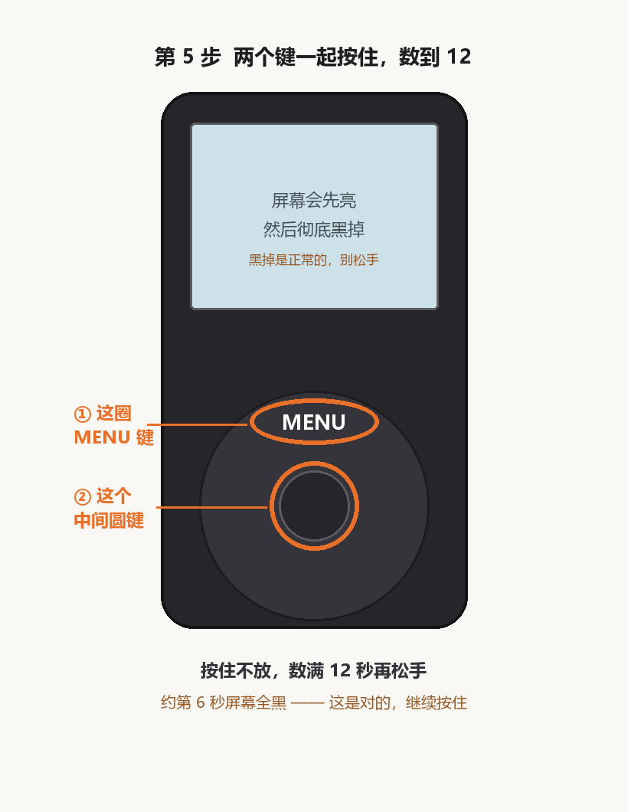

# 手把手：把 iPod 刷成 Rockbox

不用看别的文档，跟着这篇做就行。

**全程约 20 分钟。你只需要动三下手：双击、按住两个键、拔线。**

刷完之后：音乐拖进去就能播，不用 iTunes，不用同步，FLAC 也支持。

---

## 先花 30 秒，确认三件事

**① 你的 iPod 是 Classic 吗？**

翻过来看背面刻的字：

- 写着 **80GB / 120GB / 160GB**，而且是 2007 年以后买的 → **是，继续往下看**
- 写着 30GB / 60GB，叫「iPod Video」 → 不是，看[最后一节](#我的不是-classic-怎么办)
- 是 nano、mini、shuffle → 不是，看[最后一节](#我的不是-classic-怎么办)

**② 电脑是 Windows 吗？** 是 → 继续。

**③ 数据线能拷歌吗？** 以前插电脑能看到「iPod」那个盘 → 能，继续。
只能充电、电脑没反应的线不行，换一根。

三个都过了再往下。

---

## 你会用到这两个文件

仓库根目录里有两个 `.bat` 文件：

```
1-先试跑.bat      ← 先点这个，只看不写
2-开始刷机.bat    ← 再点这个，真的刷
```

**双击就行，不用敲任何命令。**

---

## 第 1 步 · 把文件放齐

你需要四个文件。前三个仓库里自带，第四个要你自己下。

**仓库里自带的三个**（在 `assets` 文件夹里，不用动）：

- `rockbox-ipod6g.zip`
- `bootloader-ipod6g.ipod`
- `mks5lboot64.exe`

**要自己下的一个 —— 主题**

去这里下：**https://themes.rockbox.org/index.php?themeid=4096**

页面上找 **Download** 按钮，下那个 **4.60 MB** 的 zip。

> 为什么主题不直接给你：作者 Dook 花了两年做这个主题，下载应该算他的。点一下链接，几秒钟的事。

下好之后，**把主题 zip 放到和那两个 bat 文件同一层**（不用解压，脚本自己会处理）。

放完大概是这样的：

```
你的文件夹/
├── 1-先试跑.bat
├── 2-开始刷机.bat
├── assets/
│   ├── rockbox-ipod6g.zip
│   ├── bootloader-ipod6g.ipod
│   └── mks5lboot64.exe
└── Themify_2.zip          ← 你刚下的主题，放这里
```

**没有主题也能刷**，只是刷完是默认界面。想先试试效果的话，可以跳过主题。

---

## 第 2 步 · 插上 iPod

用数据线连电脑。系统里会出现两个盘。

> ### ⚠️ 会弹一个窗：「使用驱动器 G: 中的光盘之前需要将其格式化」
>
> **点「取消」。每次都点取消。**
>
> 这不是故障。你的 iPod 里面装了两个盘：一个是 192MB 的小盘（苹果自己的系统用的，Windows 认不出来），一个是 70 多 G 的大盘（你的歌都在这里）。
>
> 那个弹窗问的是 192MB 那个小盘。**点了「格式化」= 把系统分区清空 = 得重新恢复。**
>
> 你只需要用那个 **70 多 G** 的盘。

---

## 第 3 步 · 双击「1-先试跑.bat」

这个只**看**，不写任何东西。你的 iPod 不会有任何变化。

会弹出一个黑窗口，往下滚几行字。你要确认两件事：

**① 它认对了盘**

```
[OK] 认定为 iPod 数据分区
     目标设备    H:  PANDA'S IPO
     可用容量    74.3 GB
```

看到 **70 多 GB** 就对了。如果它认成 192MB 的盘，先别继续。

**② 它找对了文件**

```
[OK] 固件：rockbox-ipod6g.zip
[OK] 主题：Themify_2.zip
```

两个都 OK 就可以往下。

最后它会说「预演结束，没有写入任何文件」。**看到这句就说明这步过了。**

<details>
<summary>如果它说「没有检测到任何可移动磁盘」</summary>

按顺序试：

1. 数据线换一根（最常见的原因）
2. 电脑上换个 USB 口，优先机箱后面那些
3. 确认 iPod 屏幕是亮的、开机状态

搞定之前别硬往下走。
</details>

---

## 第 4 步 · 双击「2-开始刷机.bat」

这次是真的写了。

窗口会自己开始跑，**倒计时 3 秒后动手，中间不要碰它**。会滚过很多行，不用看懂，等它停。

跑到这里就快结束了：

```
[OK] 中文字体：18-SFPro-Regular-CJK.fnt  (5838 KB, 18px)
[OK] 22-LeagueSpartan-Regular.fnt  →  换成中文字形
[OK] 配置写入完成：开机即是 Themify_2.cfg + 中文界面
```

看到「配置写入完成」，就该进入下一步了。

> **跑到一半停住不动了？** 没坏，重新双击一次就行，覆盖写入是安全的。

---

## 第 5 步 · 按住两个键（只有这一步要用手）

脚本会倒数 5 秒，然后开始找你的 iPod。你要在这段时间里把它按进一个特殊状态。

**怎么按：**



1. 两个手指一起按住 **MENU 那个圈** 和 **中间圆键**
2. **别松手，数到 12**
3. 大约第 6 秒，屏幕会**全黑、一点光都没有** —— **这是对的，继续按住**
4. 数满 12 秒再松手

松手之后，窗口里会出现：

```
[OK] 检测到设备！开始写入引导程序...
```

再过 5–10 秒：

```
引导程序安装成功
```

**成了。**

<details>
<summary>如果 60 秒过去了它说「没检测到设备」</summary>

你的 iPod **没坏**。就是按键这件事没做对，重来一次就行。

最常见的三个原因：

1. **按太短了** —— 按 5 秒就松，不行。必须数到 12。
2. **按错键了** —— 是 MENU 键 + 中间那个圆键，两个一起。不是 MENU + 播放键。
3. **数据线只能充电** —— 换一根能传文件的。

重新双击 `2-开始刷机.bat`，再来一遍。
</details>

---

## 第 6 步 · 拔线，重启，看屏幕

1. **拔掉数据线**
2. 如果它没自己关机，按住 **SELECT + MENU** 键 5–8 秒，强制重启
3. 等它开机

屏幕上应该出现：

| 你会看到 | 说明 |
|---|---|
| 一堆文字，是**中文**的 | 语言对了 |
| 背景是深色的，界面是现代风格 | 主题生效了 |
| 文字是完整的中文，**不是 □□□** | 字体替换成功 |
| 图标、进度条都正常 | 图标没被搞坏 |

**看到这些，就刷完了。**

---

## 刷完之后

**拷歌**：把音乐文件直接拖进那个 70 多 G 盘的 `Music` 文件夹。不用 iTunes，不用同步。FLAC / MP3 / M4A / WAV / APE 都行。

**媒体库（按歌手、专辑浏览）**：在 iPod 上点
`设置 → General Settings → Database → Initialize Now`
等它扫完就行，几百首歌大概几分钟。

**想换个配色**：仓库的 `references/palette.md` 里有十套现成的，放几个小文件进去，在
`设置 → 管理设置 → 浏览 .cfg 文件` 里选。

---

## 出问题只看这一节

| 你看到的 | 该怎么办 |
|---|---|
| 弹「需要格式化」 | **永远点取消**，用 70 多 G 那个盘 |
| 中文是方块 □□□ | 缺中文字体。用 Rockbox Utility 只勾 Fonts 装一次 |
| 中文是乱码 à¨æ–‡ | 编码问题。在 `.rockbox\config.cfg` 里加一行 `default codepage: gb2312` |
| 文字上下被切掉 | 字体太高。见 `references/palette.md` 的字体高度表 |
| 找不到可移动磁盘 | 换线、换 USB 口、确认 iPod 开机了 |
| 60 秒没检测到设备 | 按 12 秒，不是 5 秒。重来一次 |
| 刷完还是老系统 | 拔线后按住 SELECT+MENU 强制重启 |

还搞不定，去仓库开个 issue，把窗口里的报错贴上来。

---

## 最坏会怎样

**你这台机器不会变砖。**

真正碰硬件的只有第 5 步那 5–10 秒。就算那一步失败，结果也只是「开机程序没装上」，iPod 会回到原来的系统，跟没刷一样。

真想彻底回到原厂：重启时按住 **MENU + SELECT**，屏幕出现苹果 logo 的一瞬间改按 **SELECT + 播放键**，进到「Disk Mode」，然后在 iTunes 里点「恢复」。

刷机过程中你的歌一直在原地不动，不会被删。

---

## 我的不是 Classic 怎么办

**这篇教程里的脚本只能刷 iPod Classic（6/6.5/7 代）。**

其他型号走另一条路，更简单 —— 不用按键，全是点鼠标：

1. 去 https://www.rockbox.org/download/ 下 **Rockbox Utility**
2. 打开它，会自动认出你的 iPod
3. 勾上 **Rockbox** 和 **Fonts**，点 Install
4. 完事

（因为只有 Classic 需要那个「按住两个键」的特殊步骤，其他型号它自己就装好了。）

**主题**：去 https://themes.rockbox.org/ 左侧选你的机型，注意屏幕尺寸要对得上：

| 你的机器 | 主题该选 |
|---|---|
| Classic 6/6.5/7 代、Video 5 代 | 320×240 |
| 4 代彩色 / Photo / U2 | 220×176 |
| nano 1/2 代 | 176×132 |
| 1/2/3/4 代、mini | 160×128 / 138×110 |

nano 3/4/5 代和 shuffle 全系 **不支持 Rockbox**，刷不了。
